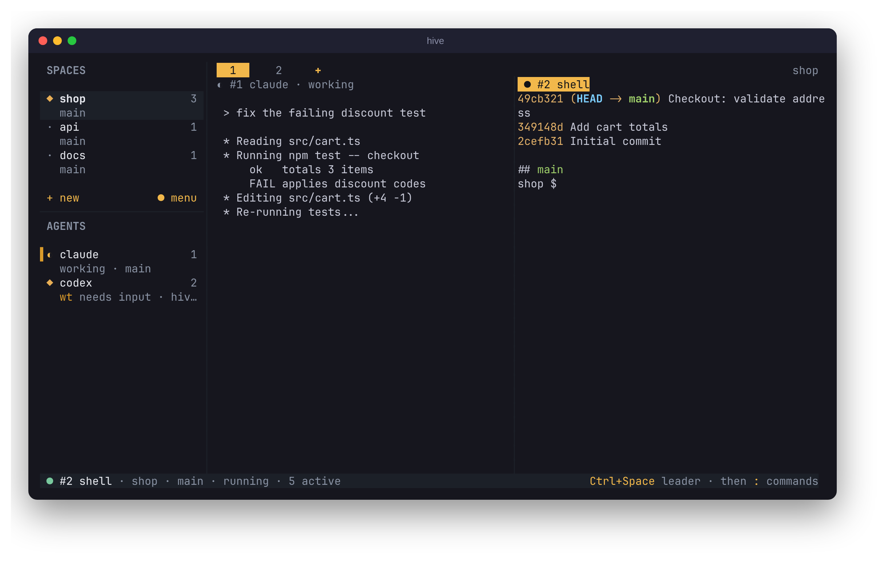
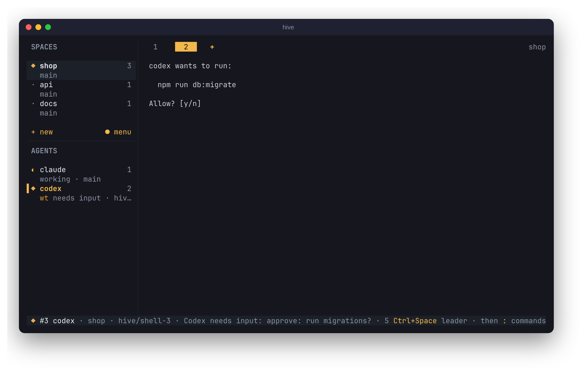
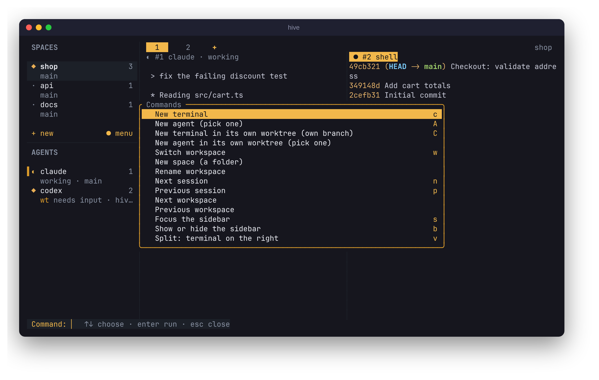

<p align="center"></p>

<h1 align="center">Hive</h1>
<p align="center"><b>One terminal. Many agents.</b><br>A lightweight, Rust-powered terminal multiplexer for AI coding agents.</p>
<p align="center"><a href="https://hive.codefrontlabs.com">Website</a> · <a href="https://hive.codefrontlabs.com/changelog">Changelog</a> · <a href="docs/user-guide.md">User guide</a> · <a href="https://github.com/jrh89/hive/releases/latest">Download</a></p>

<p align="center"></p>

Run Claude Code, Codex, Gemini CLI, OpenCode or any shell side by side, see at a glance which one is working, which one needs you and which one is done, and close the window without stopping any of them. Binaries for Linux, macOS and Windows.

## Features
- **Terminal first.** `hive` opens a terminal. Type `claude`, `codex`, ... to start an agent in it, or `cd` anywhere first. The tab row's `+` (or `Ctrl+Space t`) adds a tab; the sidebar's `+ new` (or `Ctrl+Space S`) starts a new space
- **Spaces follow you.** Every repository or folder you work in becomes a space in the sidebar; `cd` somewhere else and the tab moves there. Each space keeps its own tabs
- **Live agent status.** Working `◐`, needs input `◆`, done `●`, read from the agent's screen (herdr-compatible rules) or reported by the agent itself. The AGENTS list shows every agent in every space, so you see which one needs you wherever you are
- **Splits and tabs.** `Ctrl+Space v` / `-` split, `t` opens a tab, `Alt+←/→` switches tabs, `Alt+↑/↓` switches spaces
- **Worktrees on demand.** `Ctrl+Space C` opens a terminal in its own git worktree and branch, so two agents never edit the same files. Hive warns when two agents share a directory
- **Nothing dies with the window.** Agents live in a background daemon (`hived`). Detach, close the laptop lid or the terminal, crash the UI: reattach and get the exact screen back
- **Several windows, one session.** Others watch; only one types, and taking over is explicit (`Ctrl+Space a`)
- **Command palette.** `Ctrl+Space :` lists every action, session and space, fuzzy-searchable. Every key is configurable
- **Right-click menus.** Right-click a space (open, new terminal, rename, close), a tab (rename, split, close) or an agent (open, rename, split, terminate)
- **Works anywhere.** Truecolor, 256 or 16 colours, `NO_COLOR`, plain ASCII without Nerd Fonts; mouse support throughout
- **Safe with your work.** Worktrees with uncommitted changes are never removed without `--force` and confirmation; branches are never deleted

<table>
<tr><td></td><td></td></tr>
<tr><td align="center">Codex in its own worktree (<code>wt</code>), waiting for approval</td><td align="center">The command palette (<code>Ctrl+Space :</code>)</td></tr>
</table>

## Integrations
Optional and off by default: hidden from the palette until enabled, and their keys say how to turn them on. Each opens as an ordinary session beside your agents.

| Integration | Key | What it does |
|---|---|---|
| **Obsidian** | `Ctrl+Space N` | Opens the repository's Obsidian vault beside your agents. With `journal = true`, appends "claude finished in #3 api (main)" to today's daily note: a log of what your agents did |
| **Review** | `Ctrl+Space G` | lazygit, tig or `git diff` in a split, in the agent's directory or worktree |
| **GitHub** | `Ctrl+Space H` | `gh pr checks --watch` for the session's branch |
| **Tasks** | `Ctrl+Space T` | Pick a just/npm/make/cargo task and run it beside the agent |
| **Desktop notifications** | | A notification when an agent you aren't viewing finishes or needs input |
| **Git status** | | Changed files and commits ahead/behind under each repository space (`main ~3 ↑2`) |
| **Usage** | `Ctrl+Space U` | Token usage and cost of your agents in a pane (`ccusage blocks --live` by default; agents keep the logs, Hive just opens the tool) |

```toml
[integrations.obsidian]
enabled = true
journal = true
```

All options are in the [user guide](docs/user-guide.md#notes-obsidian-optional) and [`examples/config.toml`](examples/config.toml).

### Layouts
Name a set of panes once and open them together with `Ctrl+Space L`: in a space a layout names, it opens straight away; otherwise you pick one.

```toml
[layouts.web]
spaces = ["web"]          # opens without asking in the web space
panes = [
  { agent = "claude" },
  { run = ["npm", "run", "dev"], split = "right", label = "server" },
  { split = "down" },     # a terminal
]
```

## Install
Linux (x86_64 and aarch64), macOS (Apple silicon and Intel) and Windows 10+ (x86_64); CI tests all three. On Windows, agent status comes only from agents that report it (`hive report-agent`).

**Linux and macOS:**

```bash
curl -fsSL https://github.com/jrh89/hive/releases/latest/download/install.sh | sh
```

**Windows** (PowerShell):

```powershell
irm https://github.com/jrh89/hive/releases/latest/download/install.ps1 | iex
```

The script downloads static binaries, verifies their SHA-256 checksum and installs `hive` and `hived` to `~/.local/bin`. Set `HIVE_INSTALL_DIR` to change the location or `HIVE_VERSION=v0.4.11` to pin a version. Later, `hive update` upgrades in place (then `hive daemon stop` to restart the daemon on the new version; this ends running sessions).

**From source** (Rust ≥ 1.89):

```bash
git clone https://github.com/jrh89/hive && cd hive
cargo build --release
install -m 0755 target/release/hive target/release/hived ~/.local/bin/
```

Keep `hive` and `hived` in the same directory. Run `hive doctor` to check the setup.

## How to
**Start.** Run `hive` in any directory. You get a terminal in a space named after the repository.

**Run an agent.** Type `claude` (or `codex`, `gemini`, ...) in that terminal. The sidebar's AGENTS list picks it up with its status. Or press `Ctrl+Space A` to pick one from a list.

**Work in another repo.** Click `+ new` in the sidebar (or `Ctrl+Space S`): a new space opens with a terminal in your home folder. `cd ~/src/other-repo` and within two seconds it becomes that repository's space (or plain folder's, like `~/Work`). The tab row's `+` adds a tab to the current space instead. `Alt+↑/↓` moves between spaces, `Alt+←/→` between that space's tabs.

**Keep agents out of each other's way.** Press `Ctrl+Space C`: the new terminal opens in its own worktree on a fresh branch `hive/shell-<id>`. Start an agent there. From the command line: `hive new codex -w` (or `-b my-branch`). List and clean up with `hive worktree list` / `hive worktree rm <path>`.

**Watch two things at once.** `Ctrl+Space v` splits right, `-` splits below, `o` cycles focus, `z` zooms, `X` closes the pane and ends its session (a running agent asks first). To leave sessions running, detach instead.

**Walk away.** `Ctrl+Space d` detaches. Everything keeps running in `hived`. Run `hive` again to come back. Sessions survive the terminal, SSH drops and sleep, but not a reboot (they come back marked `◌` ended; press enter to relaunch).

**Get status from your own tools.** Anything running in a Hive terminal can report its state:

```bash
hive report-agent --agent mybot --state working --message "indexing"
hive report-agent --agent mybot --state blocked --message "need an API key"
```

**Script it.**

```bash
hive new claude -d -C ~/src/shop   # start Claude in the background
hive list                          # see sessions
hive attach 3                      # attach to one
hive kill 3                        # terminate it
```

## Supported agents
| Agent | Name in Hive | Command |
|---|---|---|
| Claude Code | `claude` | `claude` |
| Codex | `codex` | `codex` |
| Gemini CLI | `gemini` | `gemini` |
| OpenCode | `opencode` | `opencode` |
| Your shell | `shell` | `$SHELL` |
| Anything else | your choice | see [custom agents](docs/user-guide.md#custom-agents) |

Agents run unmodified in a real terminal. Hive doesn't parse their output for anything but status, and never answers their prompts.

## Commands
| Command | |
|---|---|
| `hive` | Open the UI (attaches to the newest live session, or opens a terminal) |
| `hive new [agent] [-l label] [-C dir] [-d] [-- args]` | Launch an agent |
| `hive new codex -w` / `-b <branch>` | Launch in a new git worktree (default branch `hive/<agent>-<id>`) |
| `hive list` | List sessions |
| `hive attach <id>` | Attach to a session |
| `hive kill <id>` | Terminate a session |
| `hive status` | Daemon and session summary |
| `hive report-agent --agent <name> --state <state>` | Report status from inside a session |
| `hive workspace list\|add <dir>\|rename\|rm` | Manage spaces |
| `hive worktree list\|rm <path> [--force]` | List or remove worktrees (refuses dirty ones without `--force`) |
| `hive update` | Upgrade to the latest release |
| `hive doctor` | Check config, daemon, terminal support and installed agents |
| `hive daemon start\|stop\|status` | Manage `hived` (`stop` terminates all sessions) |

## Keys
The leader is **Ctrl+Space**. Everything else goes to the terminal.

| Keys | Action |
|---|---|
| `Alt+←` / `Alt+→` | Previous / next tab in this space (no leader needed) |
| `Alt+↑` / `Alt+↓` | Previous / next space (no leader needed) |
| `Alt+1`–`9` | Jump to an agent (numbered in the AGENTS list) |
| `Ctrl+Space :` | Command palette: every command, session and space |
| `Ctrl+Space c` / `t` | New terminal / new tab in this space |
| `Ctrl+Space S` | New space (same as `+ new` in the sidebar) |
| `Ctrl+Space L` | Open a layout: panes from `[layouts]` in a new tab |
| Right-click | Menu for a space, tab or agent: rename, split, close |
| `Ctrl+Space C` | New terminal in its own worktree (own branch) |
| `Ctrl+Space A` | New agent from a list |
| `Ctrl+Space v` / `-` | Split right / below |
| `Ctrl+Space o` / `z` / `X` | Focus next pane / zoom / close pane |
| `Ctrl+Space n` / `p` | Next / previous session |
| `Ctrl+Space /` | Search sessions by name, agent, space or branch |
| `Ctrl+Space s` / `b` | Focus / hide the sidebar |
| `Ctrl+Space w` | Spaces (open, add, rename, remove) |
| `Ctrl+Space r` / `x` | Rename / terminate session |
| `Ctrl+Space d` | Detach |
| `Ctrl+Space a` | Take input control from another window |
| `Ctrl+Space ?` | Help (generated from your actual bindings) |

Every key is configurable, and so is the leader (see below). The mouse works too: click spaces, agents, tabs, `+ new` and `menu`.

## Configuration
`~/.config/hive/config.toml`. Every key is optional; [`examples/config.toml`](examples/config.toml) documents all of them. Mistakes are reported before the UI opens.

```toml
[general]
default_agent = "claude"
theme = "hive-dark"     # hive-dark, hive-light, ansi (your terminal's palette), mono

[theme]
# colors = "auto"       # auto, truecolor, 256, 16, none (NO_COLOR is honoured)
# glyphs = "auto"       # auto, unicode, ascii (no Nerd Fonts needed either way)
# accent = "#F2B84B"    # override any palette colour

[keys]
leader = "ctrl+space"   # must use Ctrl, Alt or an F-key

[keys.bind]
new_session = "c"
add_workspace = ["W", "f2"]
kill_session = ""       # unbind

[daemon]
auto_start = true
kill_timeout_secs = 3

[worktrees]
# dir = "~/worktrees"  # default: $XDG_DATA_HOME/hive/worktrees

[agents.aider]          # add or override agents
command = "aider"
args = ["--dark-mode"]
```

## Documentation
- [User guide](docs/user-guide.md): concepts, interface, workspaces and worktrees, configuration, upgrading
- [Troubleshooting](docs/troubleshooting.md): `hive doctor`, logs, common problems
- [`examples/config.toml`](examples/config.toml): every configuration key

## Architecture
`hived` owns every agent process, PTY and the authoritative terminal state. `hive` is a client that talks to it over a per-user Unix socket. See `vault/Architecture/Overview.md`.

## Development
```bash
cargo build                                            # target/debug/hive and hived
cargo fmt --all
cargo clippy --workspace --all-targets -- -D warnings
cargo test --workspace                                 # unit, PTY integration and CLI tests
scripts/smoke.sh target/debug                          # end-to-end check of built binaries
```

Integration tests run real PTYs with `/bin/sh` scripts against private daemons. No agent CLIs are needed. CI (`.github/workflows/ci.yml`) runs the above, an MSRV check, and static musl builds for x86_64 and aarch64. Pushing a `v*` tag builds release archives and creates a draft GitHub release.

## Roadmap
1. ✅ Daemon-first foundation: one session, detach/reattach
2. ✅ Multiplexing: sidebar, switching, several agents at once
3. ✅ Robust persistence: auto-reconnect, multi-client polish
4. ✅ Workspaces and git worktrees
5. ✅ Polish: command palette, themes, configurable keys
6. ✅ Testing and distribution: CI, static Linux binaries, docs
7. ✅ herdr parity: agent detection and status, split panes and tabs, global keys, mouse
8. ✅ Ease of use: herdr-style spaces/agents sidebar, clickable everything, optional integrations, `hive update`

## License
[MIT](LICENSE)
